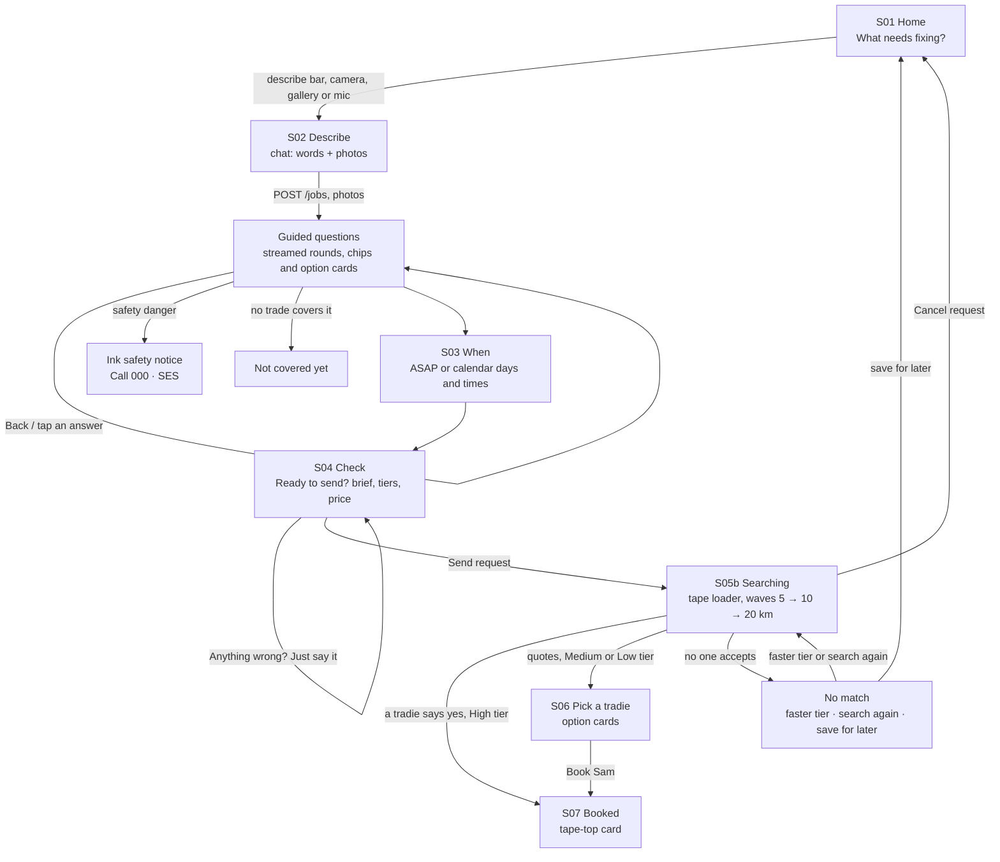
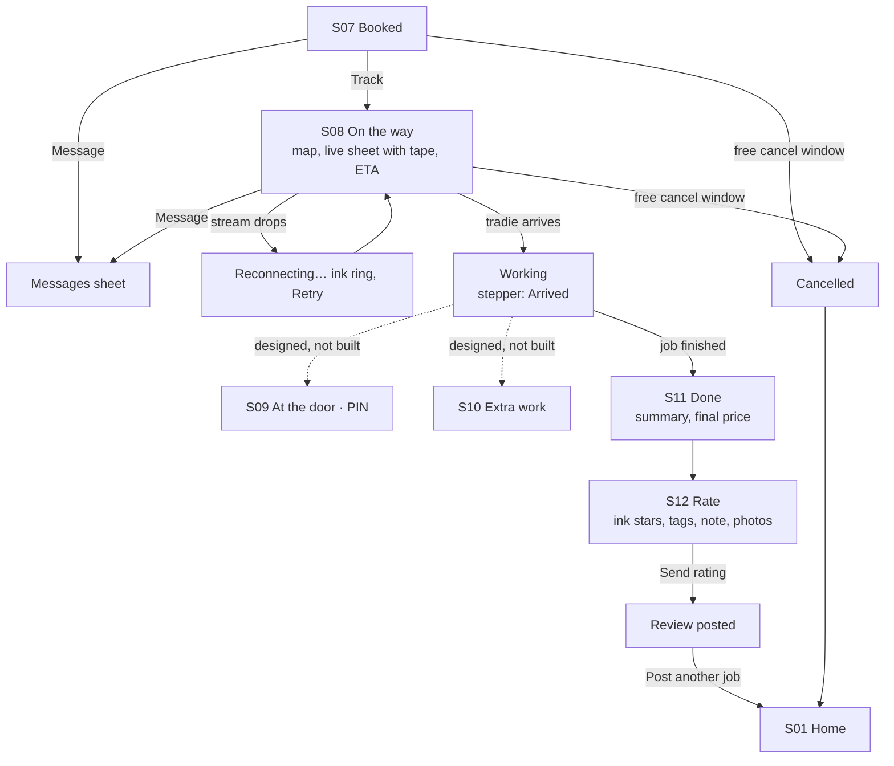
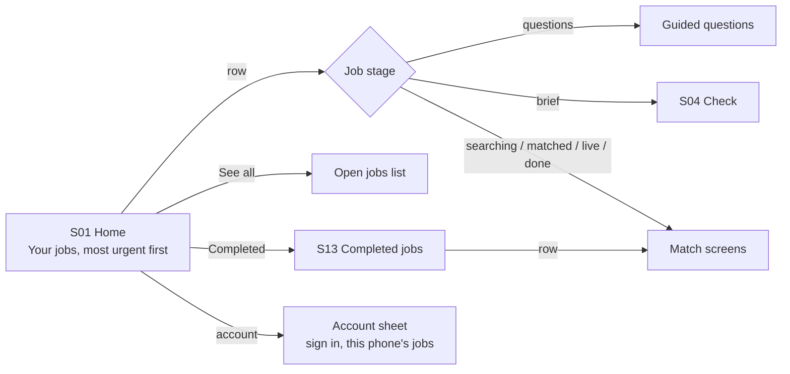

# User flows

The designed page flows are still to come from Lovish (see `decisions.md`, open questions 1 and 3). Until then, this file records **the flows as built** in the iOS and web apps on the Glass + Tape design. Each spec's Entry and Exits section (`03-screens/specs/`) is the source of truth for designed navigation; where the build differs, it says so below.

## Screen inventory

| ID | Screen | Group | Comes from | Goes to | Built? |
|---|---|---|---|---|---|
| S01 | Home | Booking | Launch | S02, S05b, S08–S11, S13 | Yes. iOS: no tab bar; jobs list + describe bar |
| S02 | Describe | Booking | S01 | S03 | Yes. Chat plus guided questions |
| S03 | When | Booking | S02 | S04 | Yes. Calendar or urgency option cards |
| S04 | Check | Booking | S03 | S05 (via the Send request motion) | Yes. No motion yet |
| S05 | Home · sent | Booking | S04 | S05b, S06 | Partly. iOS Home shows the sent row with the plane icon; the app opens the search straight after sending |
| S05b | Request status (sheet) | Booking | S05 row | S05, S06, Home (cancelled) | Yes. Glass sheet with tape over the map |
| S06 | Match + time | Booking | S05, S05b, push | S07 | Yes. Quotes as option cards (Medium and Low tiers) |
| S07 | Booked | Booking | S06 | S08, S01 | Yes |
| S08 | On the way | During | S07, S01, push | S09 | Yes |
| S09 | At the door | During | S08, push | In progress, then S10 or S11 | **No.** No PIN in the API |
| S10 | Extra work | During | Push, S01 | Back to in progress | **No.** No extra-work approval in the API |
| S11 | Done · pay | During | Push | S12 | Partly. Summary and final price; no payment |
| S12 | Rate | During | S11, S13, S14 | S01 | Yes |
| S13 | Completed jobs | After | S01 | S14, S12 | iOS only |
| S14 | Completed job | After | S13, receipt email | S12, S02 (rebook) | Opens the finished match screen; no rebook yet |

## Core booking (S01 → S07)

## Job day (S07 → S12)

## Returning to a job (iOS)

Home sorts jobs: no tradie found › on the way or working › request sent › booked › saved › not sent yet. Live and in-flight rows get the tape marker; a sent request shows the landed paper plane.

## Still to design or build

- [ ] **Home typing flow:** depends on open decision 1. Today the describe bar opens S02.
- [ ] **Send request motion** (`04-motion/`): the plane landing on Home.
- [ ] **At the door (S09), extra work (S10), payment (S11):** need API support first.
- [ ] **Rebook:** S13 → S14 → S02 with the tradie preselected.
- [ ] **Failure paths in the design:** tradie withdraws, payment declined.
- [ ] **Sign-up, address and payment setup, Safety & help sheet, account:** not designed yet. Account is built from the existing components in the meantime.
