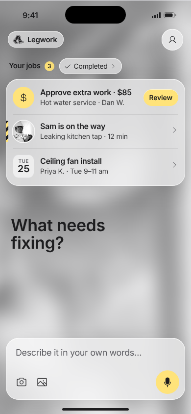
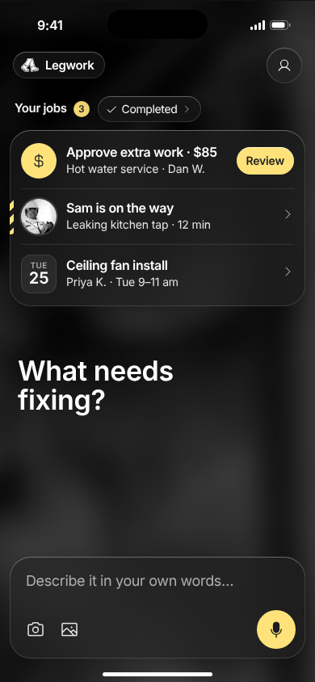

# S01 · Home

 

**Group:** Booking · **Frame:** iPhone 390 × 844 pt · **@3x:** `../light/S01-home@3x.png`

## Purpose
Start a new job, or get back to one that needs you. All open jobs sit in one list, most urgent first.

## Entry
App launch (signed in). Tapping the logo from anywhere.

## Exits
Describe bar or mic → S02. Job row → that job's live screen (S05b for a request, S08–S11 for an active job, a booking detail for an upcoming one). Review chip → S10. Completed pill → S13. Account → Account (out of scope).

## Layout and components
- Background: sharp black and white photo, blurred (`lw-bg--blur`).
- Floating controls: logo pill on the left (`lw-glass--pill`), account on the right (`lw-glass--circle`).
- A "Your jobs" label with `lw-count`, then a "Completed" glass pill.
- One glass list (`lw-li` rows): needs you › live › booked. The live job gets `lw-tape-marker`.
- `display` headline "What needs fixing?" at y 440, 22pt from the sides.
- Describe bar: a glass panel 30pt from the bottom, with camera, gallery and the yellow mic.

## Data
- Each job has: id, status (`needs_action`, `en_route`, `on_site`, `booked`, `requested`), title, tradie first name and initial, a time or ETA, and an optional amount awaiting approval.
- Sort by status (`needs_action` first, then live, then booked), then by soonest time.

## States and edge cases
- **No open jobs:** hide the jobs block. The headline moves up, and the Completed pill sits on its own above it if any past jobs exist.
- **More than 3 open jobs:** show 3 rows plus a "See all (n)" row.
- **Requested, no tradie yet:** the "Request sent · waiting for a yes" row from S05, with the paper-plane icon and the tape marker.
- **Offline:** show the list from cache, and an ink note above it: "You're offline. Showing your last update."
- **Loading:** the glass list with 3 skeleton rows (`glass-inner` bars). No spinner.

## Interactions
- Tap the describe bar: it expands into the composer. **Open:** where the jobs go while typing (see `01-flows/decisions.md`).
- Hold the mic: start voice dictation straight away and go to S02 with the transcript.
- Pull to refresh the jobs list.

## Accessibility
- Headline is the screen's first heading.
- Each row reads as one element, for example: "Sam is on the way, leaking kitchen tap, 12 minutes. Live."
- The mic button's label is "Describe by voice".

---
Copy for this screen is in `05-content/copy-deck.md`. Components are in `02-design-system/components.md`. Sample data (names, prices, PINs and licence numbers) is fictional.
