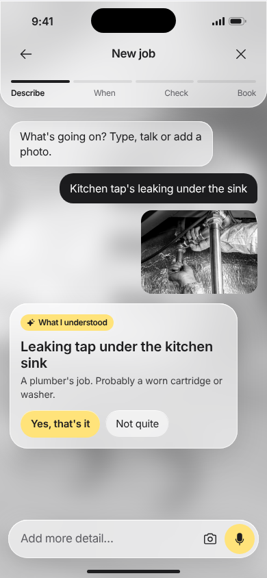
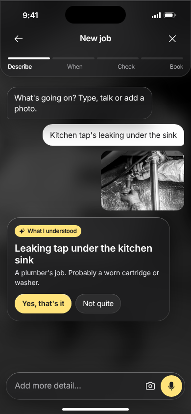

# S02 · Describe

 

**Group:** Booking · **Frame:** iPhone 390 × 844 pt · **@3x:** `../light/S02-describe@3x.png`

## Purpose
Capture the problem in the customer's own words, from text, voice or photos. The assistant plays back what it understood so the customer can confirm it.

## Entry
S01 describe bar, mic, camera or gallery.

## Exits
"Yes, that's it" → S03. "Not quite" → the assistant asks one follow-up question. Close → a confirm sheet ("Discard this job?"), then S01. Back → S01, keeping the draft.

## Layout and components
- Background: blurred photo. Top bar with the booking stepper on Describe.
- Chat stack starts at y 176: incoming bubbles are glass, outgoing are `bubble-out`, photo bubbles are 170 × 122.
- "What I understood" card: a glass panel with a yellow tag, a `title-3` summary, a `caption` explanation, and Yes / Not quite chips.
- Composer: a glass pill 30pt from the bottom.

## Data
- The scripted turn plus an LLM call return: `summary`, `trade` (plumber, electrician, …), `likely_cause` (optional), `confidence`, and `follow_up_question` (optional).
- Photos: up to 6, compressed to the long edge 2048px. Shown in black and white in the UI; the originals are stored in colour.

## States and edge cases
- **Assistant thinking:** an incoming glass bubble with three pulsing dots. Under Reduce Motion, the text "Thinking…" instead.
- **Low confidence:** skip the card and ask a single follow-up question as a bubble with 2–4 chips.
- **Voice:** the mic turns into a stop button, a live transcript appears in the outgoing bubble, and you tap to stop.
- **Photo upload fails:** the photo bubble gets a 2pt ink ring and "Didn't send. Tap to retry."
- **Possible emergency** (gas, flooding, sparks): show an ink safety note at the top of the chat: "If anyone's in danger, call 000." The emergency path is out of scope for v1.

## Interactions
- The keyboard pushes the composer up, and the chat scrolls to the newest message.
- Tap a photo to view it full screen.

## Accessibility
- New assistant messages are announced (the live-region equivalent).
- Chips are buttons.
- The photo bubble's label is "Your photo, 1 of 2".

---
Copy for this screen is in `05-content/copy-deck.md`. Components are in `02-design-system/components.md`. Sample data (names, prices, PINs and licence numbers) is fictional.
