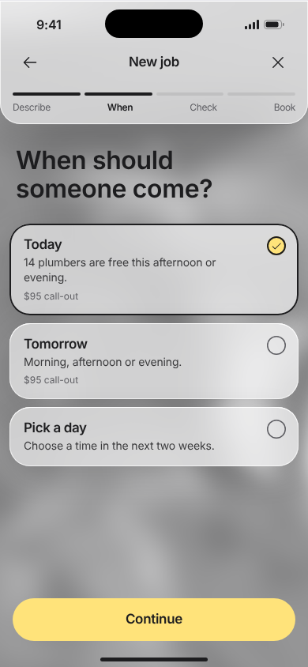
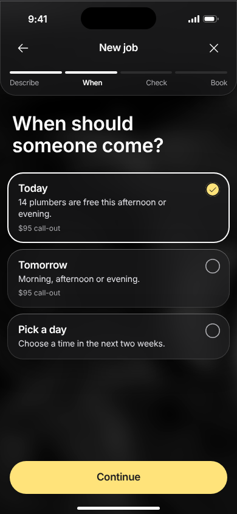

# S03 · When

 

**Group:** Booking · **Frame:** iPhone 390 × 844 pt · **@3x:** `../light/S03-when@3x.png`

## Purpose
Choose when. Three simple choices, with the price repeated so there are no surprises.

## Entry
S02 confirmed.

## Exits
Continue → S04. "Pick a day" → the system date and time sheet (within the next 14 days, in 2-hour windows), then S04. Back → S02.

## Layout and components
- Top bar with the stepper on When.
- `title-1` "When should someone come?" at y 184.
- A stack of 3 `lw-option` cards from y 282, with Today selected by default when tradies are available.
- The primary button "Continue" 34pt from the bottom.

## Data
- `available_count_today` and `call_out_fee` per trade and suburb.

## States and edge cases
- **Nobody free today:** the Today card is disabled, with the detail "No plumbers free today". Tomorrow is preselected.
- **After 8 pm:** the Today card is hidden.
- **Pick a day chosen:** the card's detail shows the chosen window ("Thu 27 Nov, 8–10 am") with an Edit link.

## Interactions
- Tapping a card selects it. Continue moves on; nothing advances automatically.

## Accessibility
- A radio group: "When should someone come? Today, selected, 1 of 3."

---
Copy for this screen is in `05-content/copy-deck.md`. Components are in `02-design-system/components.md`. Sample data (names, prices, PINs and licence numbers) is fictional.
