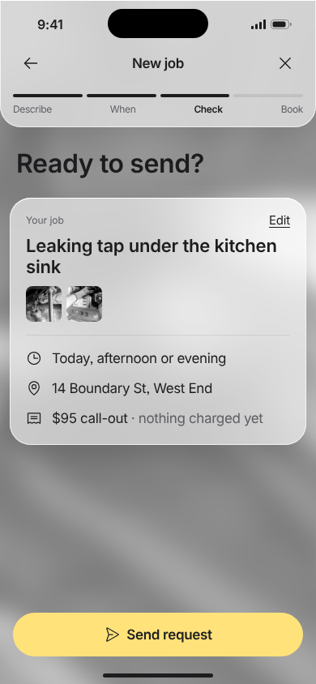
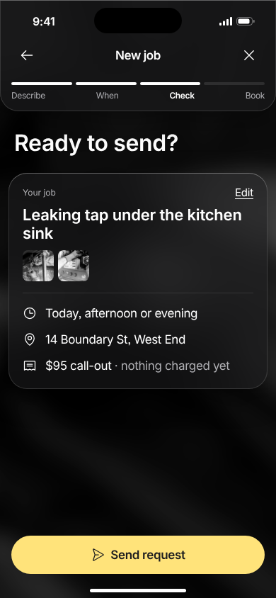

# S04 · Check

 

**Group:** Booking · **Frame:** iPhone 390 × 844 pt · **@3x:** `../light/S04-check@3x.png`

## Purpose
One last look before sending. Key details only, with one Edit link, and a clear statement that nothing is charged yet.

## Entry
S03.

## Exits
Send request → the paper-plane motion (`04-motion/`, 2.8 s) → S05 (Home, with the new job on top). Edit → S02, keeping the chat. Back → S03.

## Layout and components
- Top bar with the stepper on Check.
- `title-1` "Ready to send?"
- A glass card at y 244: "Your job" and Edit, the `title-2` summary, photo thumbs, a divider, then three icon rows (when, where, price).
- The primary button "Send request" with a paper-plane icon.

## Data
- Address: the default saved address. Changing it is through Edit, which opens an address sheet. **Open:** where the address is first captured; it's assumed to be at sign-up.

## States and edge cases
- **Sending:** the button reads "Sending…" and is disabled. The motion starts only once the server accepts the request.
- **Send fails:** stay on S04. The card gets a 2pt ink ring and a bold note: "Couldn't send. Check your connection and try again."
- **No payment method on file:** Send request opens the Apple Pay or card sheet first, to place the $95 hold.

## Interactions
- Press scale .96 on Send. Yellow shows behind the page while it folds into a paper plane; then Home dissolves in and the plane glides into the new job's row. Tapping during the motion skips to S05.

## Accessibility
- Under Reduce Motion, Send cross-fades straight to S05.
- The price row reads "$95 call-out, nothing charged yet."

---
Copy for this screen is in `05-content/copy-deck.md`. Components are in `02-design-system/components.md`. Sample data (names, prices, PINs and licence numbers) is fictional.
