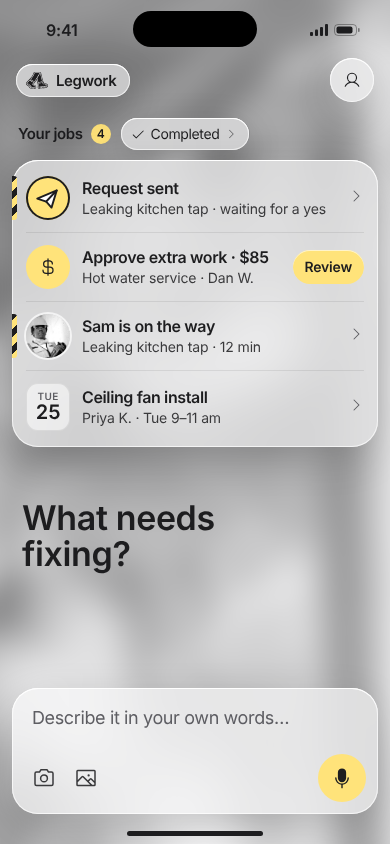
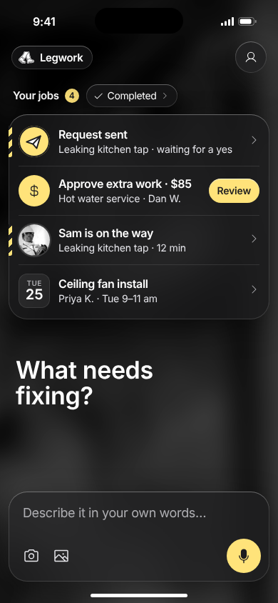

# S05 · Home · sent

 

**Group:** Booking · **Frame:** iPhone 390 × 844 pt · **@3x:** `../light/S05-home-sent@3x.png`

## Purpose
Confirm the request went out without adding a screen. The paper plane lands on Home and becomes the new job's icon, and the row says "Request sent · waiting for a yes".

## Entry
The S04 motion (end frame), or Reduce Motion's cross-fade.

## Exits
Tap the new row → S05b (request status sheet). First tradie accepts → S06 (push notification if the app is in the background; in the foreground the row changes to "Sam can come today" with a Book chip). Other rows → as on S01.

## Layout and components
- S01 layout, with one new row at the top of the jobs list:
- Leading: a 44pt yellow circle with a 2pt ink ring and the landed paper plane (`lw-sent-icon`, asset `06-assets/brand/legwork-sent-plane.svg`). The row has `lw-tape-marker` (in flight).
- Title "Request sent", sub line "{job} · waiting for a yes", chevron.
- The job count ticks up (3 → 4). The headline moves down to make room.

## Data
- The new job: id, status `requested`, title, `notified_count`. A live status stream (SSE or push) updates the row.

## States and edge cases
- **Someone says yes:** the row title becomes "{tradie} can come {day}" with a yellow `Book` compact chip; a success haptic plays. Tapping it opens S06.
- **No reply after 10 minutes:** sub line "Still looking · widened to 10 km".
- **No one at all (after 30 minutes):** title "No {trade}s free right now", chip "Pick a time" → S03.
- **Cancelled:** the row leaves the list with a 200ms exit, and the count ticks down.

## Interactions
- The row's icon springs in (.3 → 1) and the text slides in 8pt with blur; the count pops 1 → 1.3 → 1. See `04-motion/motion-spec.md`.

## Accessibility
- On arrival, announce "Request sent. Waiting for a plumber." The plane is decorative; the row text carries the meaning.
- The row reads as one element: "Request sent, leaking kitchen tap, waiting for a yes. In progress."

---
Copy for this screen is in `05-content/copy-deck.md`. Components are in `02-design-system/components.md`. Sample data (names, prices, PINs and licence numbers) is fictional.
