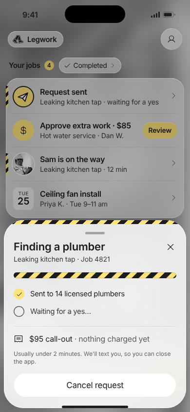
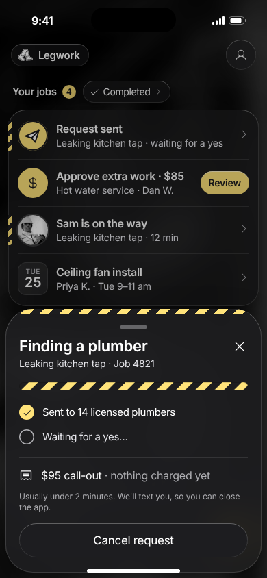

# S05b · Request status

 

**Group:** Booking · **Frame:** iPhone 390 × 844 pt · **@3x:** `../light/S05b-request-status@3x.png`

## Purpose
Show where the request is up to, reassure, and let the customer cancel. This replaces the old full-screen Request sent page.

## Entry
Tap the "Request sent" row on Home (S05).

## Exits
Close or swipe down → S05. Cancel request → a confirm alert, then the job is cancelled and you return to Home. A tradie accepts while the sheet is open → the sheet closes and S06 opens.

## Layout and components
- A bottom sheet (`lw-glass--sheet`: denser glass, radius 40, 8pt from the screen edges) with `lw-tape-top`, over Home dimmed with a black scrim at 28%.
- Grabber, then `title-2` "Finding a plumber", the sub line "{job} · Job {number}", and close.
- The tape loader (request in flight), then the status list: sent ✓ / waiting.
- A divider, then the money line "$95 call-out · nothing charged yet", and the reassurance footnote.
- A secondary button "Cancel request" (never red).

## Data
- `notified_count`, `suburb`, `trade`, `job_number`, `call_out_fee`, and the live status stream.

## States and edge cases
- **Someone says yes:** the second status row becomes done ("Sam said yes"), then after 600ms the sheet hands over to S06.
- **No reply after 10 minutes:** the loader stops; status "Still looking. We've widened the search to 10 km.", plus a secondary "Try another time".
- **No one at all (after 30 minutes):** "No plumbers are free right now.", with the primary "Pick another time" and the link "Cancel request".
- **App in background:** push notification "Sam can come today, 2–4 pm. Tap to book."

## Interactions
- iOS sheet with a medium detent. Cancel asks to confirm ("Cancel this request? Nothing has been charged.").

## Accessibility
- The loader is static under Reduce Motion and reads "Waiting for a reply".
- Focus moves to the sheet title when it opens.

---
Copy for this screen is in `05-content/copy-deck.md`. Components are in `02-design-system/components.md`. Sample data (names, prices, PINs and licence numbers) is fictional.
