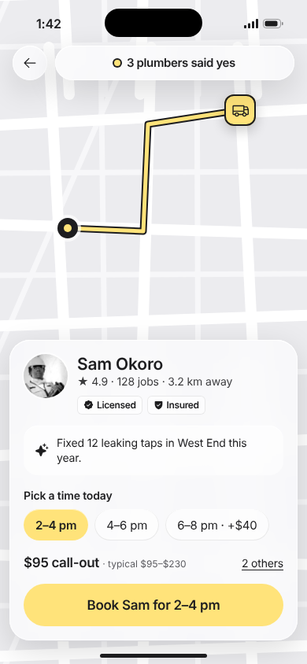
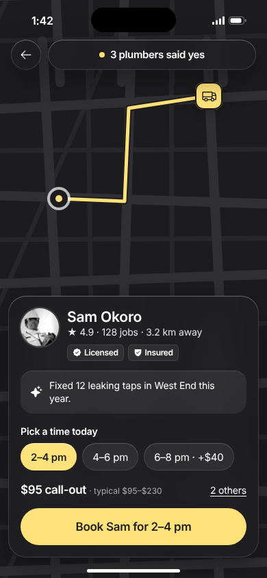

# S06 · Match + time

 

**Group:** Booking · **Frame:** iPhone 390 × 844 pt · **@3x:** `../light/S06-match-time@3x.png`

## Purpose
Show who said yes, why they're a good fit, and when they can come. Book in one tap.

## Entry
S05 or S05b (first acceptance), or a push notification.

## Exits
Book → S07 (places or keeps the $95 hold). "2 others" → a sheet listing the other tradies who accepted. Back → S05 (Home).

## Layout and components
- Background: the map (`lw-map`) with the van marker (tradie) and home marker, joined by the route.
- Floating controls: back, plus a status pill "3 plumbers said yes".
- A glass sheet 30pt from the bottom: avatar, name (`title-3`), rating · jobs · distance, the Licensed and Insured badges, a "why this tradie" inner well with a sparkle icon, "Pick a time today" chips, the price row with "2 others", and the primary "Book Sam for 2–4 pm".

## Data
- Each tradie has: name, photo, rating, job count, distance, licence number and type, insured flag, a `why` line (generated, under 60 characters), slots [{window, surcharge}], and a typical price range.

## States and edge cases
- **Only one accepted:** hide "2 others" and say "Sam said yes".
- **A slot has a surcharge:** the chip label reads "6–8 pm · +$40". The button label includes the total if a surcharge applies.
- **The tradie withdraws before booking:** the sheet swaps to the next tradie, with an ink note "Sam's no longer free. Here's Priya."

## Interactions
- Changing the time chip updates the button label.
- Tap the avatar to see a profile sheet (reviews, licence).

## Accessibility
- The map is decorative; the sheet carries all the information.
- Badges read "Licensed plumber, licence QBCC 1501234. Insured."

---
Copy for this screen is in `05-content/copy-deck.md`. Components are in `02-design-system/components.md`. Sample data (names, prices, PINs and licence numbers) is fictional.
