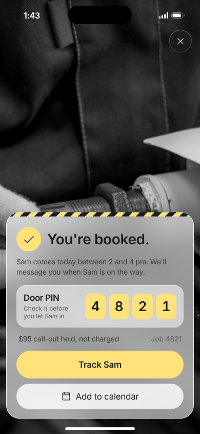
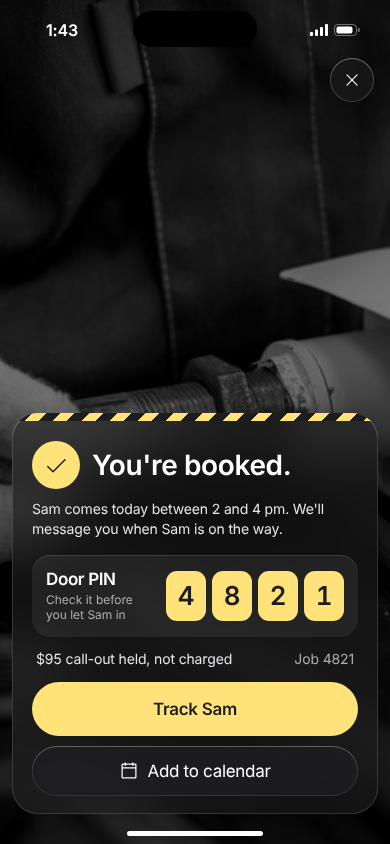

# S07 · Booked

 

**Group:** Booking · **Frame:** iPhone 390 × 844 pt · **@3x:** `../light/S07-booked@3x.png`

## Purpose
Booked. Give the customer the door PIN, the time window and the money position, then get out of the way.

## Entry
S06 Book.

## Exits
Track Sam → S08 (from the time Sam starts driving; before that, a booked-detail state of S08 without the map route). Add to calendar → the system event sheet. Close → S01.

## Layout and components
- Background: a sharp black and white photo with `lw-shade`. Status bar and home indicator are white.
- Close: a dark glass circle at the top right.
- A glass card with `lw-tape-top`, 30pt from the bottom: a yellow done badge and "You're booked.", a confirmation line, a PIN inner well, the "$95 call-out held, not charged" line with the job number, the primary "Track Sam" and the secondary "Add to calendar".

## Data
- `pin` (4 digits, generated per job), `window`, `job_number`, `hold_amount`.

## States and edge cases
- **Booked for a later day:** the copy reads "Sam comes Thu 27 Nov between 8 and 10 am." and the primary button becomes "Done". Track appears on Home on the day.

## Interactions
- Haptic on arrival (success).

## Accessibility
- The PIN reads as "PIN 4 8 2 1".
- Announce "You're booked."

---
Copy for this screen is in `05-content/copy-deck.md`. Components are in `02-design-system/components.md`. Sample data (names, prices, PINs and licence numbers) is fictional.
