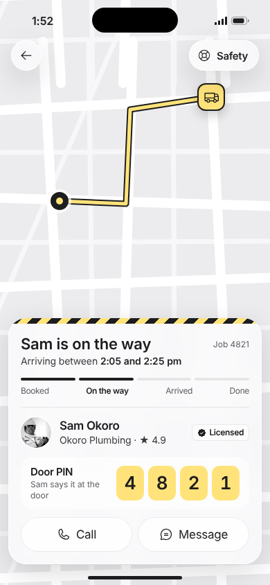
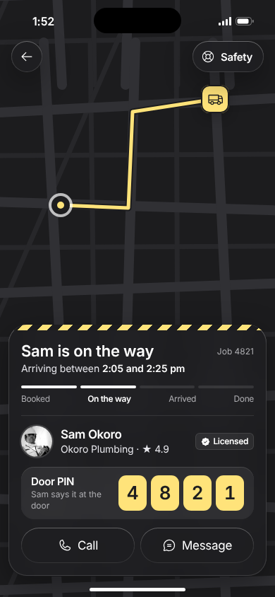

# S08 · On the way

 

**Group:** During the job · **Frame:** iPhone 390 × 844 pt · **@3x:** `../light/S08-on-the-way@3x.png`

## Purpose
Live tracking while the tradie drives over. Arrival is shown as a window, not a clock time. The PIN, contact and safety are all in reach.

## Entry
S07 Track, the Home live-job row, or the push notification "Sam is on the way".

## Exits
Sam arrives (geofence or tradie taps Arrived) → S09. Call → the system call (a masked number). Message → in-app chat (out of scope). Safety → the Safety & help sheet. Back → S01.

## Layout and components
- Background: the map with the van marker moving along the route.
- Floating controls: back on the left, and a "Safety" glass pill with a lifebuoy icon on the right.
- A glass sheet with `lw-tape-top` (the live job), 30pt from the bottom: `title-2` "Sam is on the way", "Arriving between 2:05 and 2:25 pm" (the window in bold), the job number, the job stepper on On the way, a divider, the tradie row with the Licensed badge, a PIN inner well, and Call / Message secondary buttons.

## Data
- `eta_window` (start and end), van location every 10s, and the stepper state. Keep the vehicle plate out of the UI.

## States and edge cases
- **Running late** (window moves by 15 minutes or more): a line under the title, "Running about 15 min late", and a push notification.
- **Location unavailable:** hide the van marker and keep the window.
- **Sheet dragged up:** the full job summary (what you asked for, photos, price so far).

## Interactions
- The sheet has two positions (as shown, and expanded). The map pans, but the sheet doesn't move with it.

## Accessibility
- The window updates are announced at most once a minute.
- The Safety pill's label is "Safety and help".

---
Copy for this screen is in `05-content/copy-deck.md`. Components are in `02-design-system/components.md`. Sample data (names, prices, PINs and licence numbers) is fictional.
