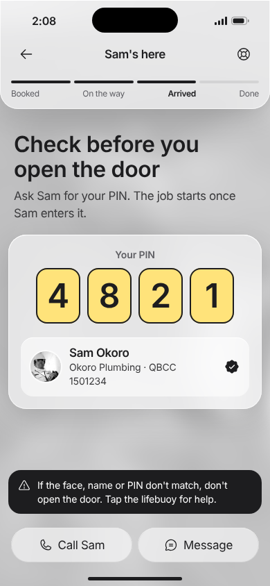
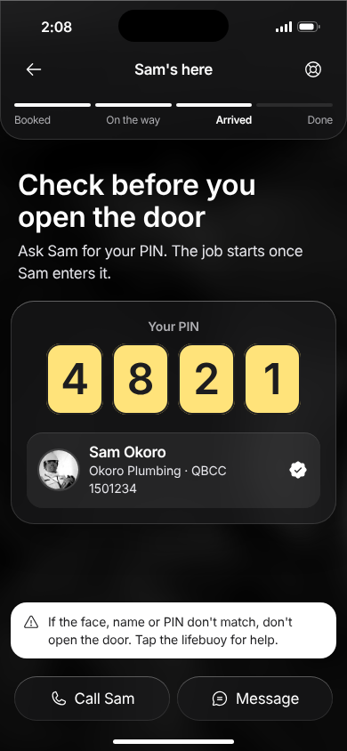

# S09 · At the door

 

**Group:** During the job · **Frame:** iPhone 390 × 844 pt · **@3x:** `../light/S09-at-the-door@3x.png`

## Purpose
The trust moment at the door. Make sure the right person is standing there before the customer opens it.

## Entry
The tradie arrives, triggered by the geofence or the tradie tapping Arrived. Push notification: "Sam's at your door. Check the PIN."

## Exits
The tradie enters the correct PIN in their app → the job starts, and this screen becomes the in-progress state (S08 layout with the stepper on Arrived, and the title "Sam's working on it"). Lifebuoy → Safety & help. Back → S01.

## Layout and components
- Background: a blurred photo with the strong wash. Top bar "Sam's here" with the job stepper on Arrived and a lifebuoy at the top right.
- `title-1` "Check before you open the door" and a one-line instruction.
- A glass panel: the label "Your PIN", the large PIN (64 × 80 digits), and an inner well with the avatar, name, business and licence number, plus a seal-check icon.
- An ink safety note 104pt from the bottom.
- Call Sam / Message as secondary buttons.

## Data
- The tradie's verified identity: photo, name, business, and licence number and type.

## States and edge cases
- **Wrong PIN entered** (on the tradie's side): the customer sees no error. After 3 wrong tries, the customer gets an ink note: "Sam's had trouble with the PIN. Call Sam before opening the door."

## Interactions
- None needed from the customer apart from reading. Don't add a "Let in" button: the PIN entry is the handshake.

## Accessibility
- The large PIN reads as one element.
- The safety note is a static text element, read after the PIN.

---
Copy for this screen is in `05-content/copy-deck.md`. Components are in `02-design-system/components.md`. Sample data (names, prices, PINs and licence numbers) is fictional.
