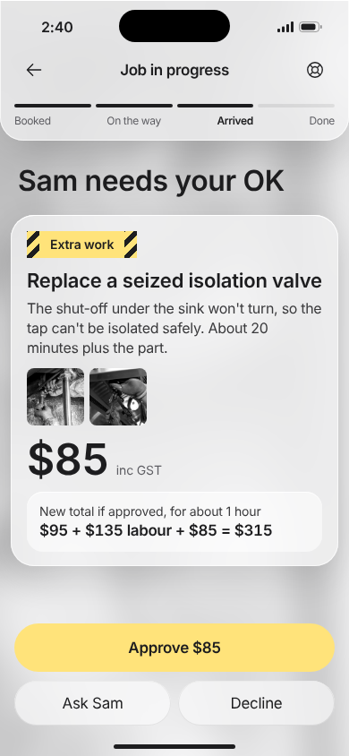
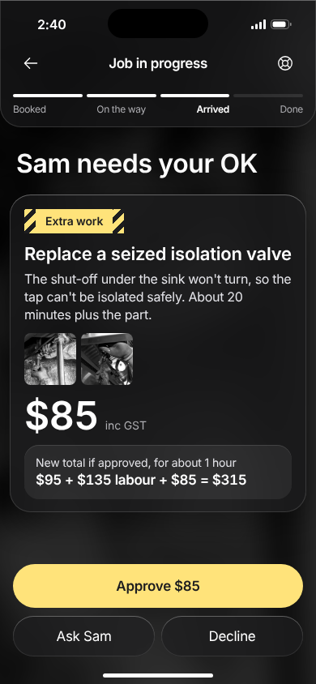

# S10 · Extra work

 

**Group:** During the job · **Frame:** iPhone 390 × 844 pt · **@3x:** `../light/S10-extra-work@3x.png`

## Purpose
The tradie needs approval for more work mid-job. Show the amount, the reason, photos and the new total, and make it clear nothing is charged until the customer approves.

## Entry
Push notification "Sam needs your OK for $85 of extra work", or the Home "Review" row.

## Exits
Approve → back to the in-progress state, with a success haptic and a toast "Approved. Sam's been told.". Ask Sam → chat with the request quoted. Decline → a confirm sheet ("Sam will finish the original job only."), then back to in progress.

## Layout and components
- Background: a blurred photo with the strong wash. Top bar "Job in progress" with the stepper on Arrived and a lifebuoy.
- `title-1` "Sam needs your OK".
- A glass card: the `lw-tape-label` "Extra work", the `title-2` item, a `callout` reason, 64pt photo thumbs, the amount in `figure` with "inc GST", and an inner well with the new total worked through in plain figures.
- At the bottom: the primary "Approve $85", with Ask Sam / Decline as secondary buttons.

## Data
- `extra_item`: title, reason, photos, amount including GST, and the new total breakdown. Timestamp of the request.

## States and edge cases
- **Several items:** one card per item, each with its own approve, and a combined total at the bottom.
- **Request expires** (30 minutes with no answer): Sam is notified, and the card says "This request expired. Sam can send it again."

## Interactions
- Approve requires no extra authentication (it's within the hold limit). If the new total exceeds the hold by more than $500, ask for Face ID.

## Accessibility
- The amount reads as "85 dollars including GST".
- Decline is never styled as destructive red.

---
Copy for this screen is in `05-content/copy-deck.md`. Components are in `02-design-system/components.md`. Sample data (names, prices, PINs and licence numbers) is fictional.
