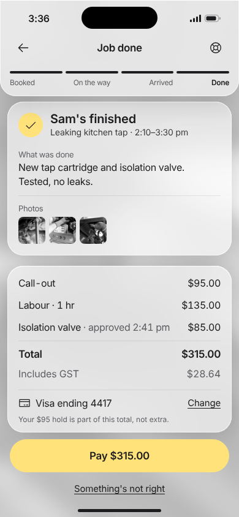
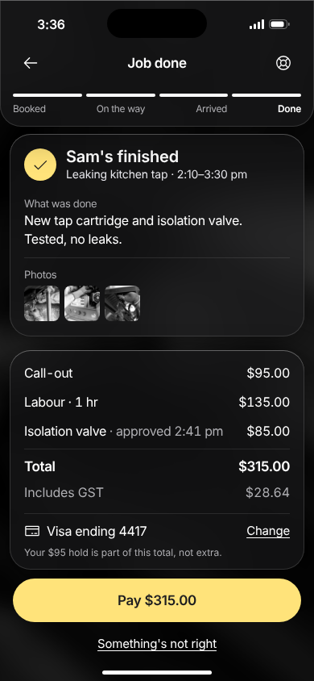

# S11 · Done · pay

 

**Group:** During the job · **Frame:** iPhone 390 × 844 pt · **@3x:** `../light/S11-done-pay@3x.png`

## Purpose
The job is done. Show what was done, the itemised total with GST, and take payment in one tap.

## Entry
The tradie marks the job complete. Push notification: "Sam's finished. Check and pay."

## Exits
Pay → Apple Pay or the saved card → S12. "Something's not right" → the help flow (dispute; out of scope), and payment is paused. Change → the payment method sheet.

## Layout and components
- Background: a blurred photo with the strong wash. Top bar "Job done" with the stepper on Done and a lifebuoy.
- A summary card from y 166: a yellow check badge, "Sam's finished" with the time on site, "What was done", and photos.
- A price card from y 434: call-out, labour, approved extras with the approval time, the total, the GST line, the payment method with Change, and the note that the hold is part of the total.
- At the bottom: the primary "Pay $315.00" and the link "Something's not right".

## Data
- Line items: label, amount, approved_at (optional). Total, GST, payment method, and the hold applied.

## States and edge cases
- **Payment processing:** the button reads "Paying…" and is disabled.
- **Payment fails:** a 2pt ink ring on the price card, and a bold note: "Your card was declined. Try another card." with Change highlighted.
- **Not paid in 24 hours:** the saved card is charged automatically. Tell the customer up front with a footnote on this screen. **Open:** confirm the policy.

## Interactions
- Apple Pay sheet when available.

## Accessibility
- The price rows read label and amount together.
- The total is announced as "Total 315 dollars, including GST 28 dollars 64."

---
Copy for this screen is in `05-content/copy-deck.md`. Components are in `02-design-system/components.md`. Sample data (names, prices, PINs and licence numbers) is fictional.
