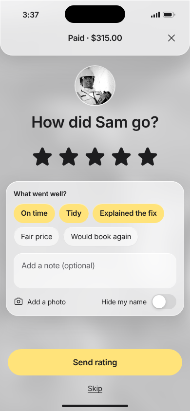
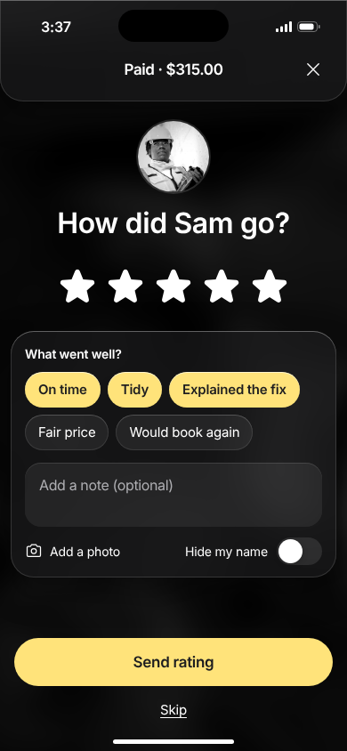

# S12 · Rate

 

**Group:** During the job · **Frame:** iPhone 390 × 844 pt · **@3x:** `../light/S12-rate@3x.png`

## Purpose
Quick, optional rating straight after paying. Stars, tags, an optional note and photo. No tipping.

## Entry
S11 payment succeeds. Also from S13 and S14 via "Rate".

## Exits
Send rating → S01, with the toast "Thanks. Your receipt is in your email.". Skip or close → S01. The job stays unrated and shows Rate in S13.

## Layout and components
- Background: a blurred photo with the strong wash. A top bar without a stepper, titled "Paid · $315.00", with close.
- An 80pt avatar, then `title-1` "How did Sam go?".
- 44pt input stars, centred.
- A glass card: "What went well?" chips, a note field, "Add a photo", and a Hide my name switch.
- The primary "Send rating" and the link "Skip".

## Data
- rating 1–5, tags[], note, photo, `hide_name`.

## States and edge cases
- **3 stars or fewer:** the tag title changes to "What could be better?", with tags Late, Messy, Didn't explain, Price higher than quoted and Had to come back, plus the link "Get help with this job".
- **No stars selected:** Send rating is disabled.

## Interactions
- Tap or drag across the stars.

## Accessibility
- The stars are an adjustable control (swipe up or down to change).
- Tags are toggle buttons.

---
Copy for this screen is in `05-content/copy-deck.md`. Components are in `02-design-system/components.md`. Sample data (names, prices, PINs and licence numbers) is fictional.
