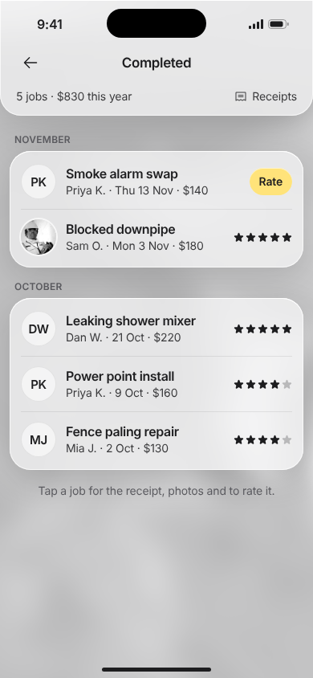
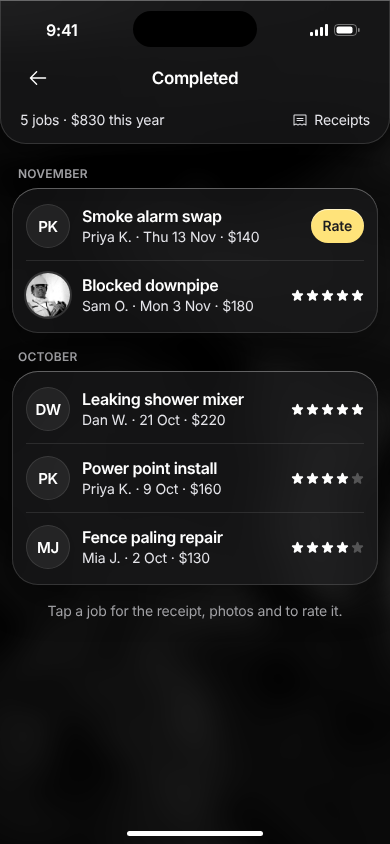

# S13 · Completed jobs

 

**Group:** After the job · **Frame:** iPhone 390 × 844 pt · **@3x:** `../light/S13-completed-jobs@3x.png`

## Purpose
Past jobs, for receipts, ratings and rebooking.

## Entry
S01 "Completed" pill.

## Exits
Row → S14. Rate → S12. Receipts → a list of tax invoices (share or download PDF). Back → S01.

## Layout and components
- Background: a blurred photo with the strong wash.
- Top bar "Completed", with the summary "5 jobs · $830 this year" and a Receipts link.
- Month section labels, each with a glass list of `lw-li` rows: initials or avatar, title, the tradie · date · price line, and either a Rate chip or stars.

## Data
- Paged by month, 20 jobs a page.

## States and edge cases
- **Empty:** "No finished jobs yet. They'll show up here with receipts."

## Interactions
- Infinite scroll by month.

## Accessibility
- Rows read as "Smoke alarm swap, Priya K, 13 November, 140 dollars, not rated".

---
Copy for this screen is in `05-content/copy-deck.md`. Components are in `02-design-system/components.md`. Sample data (names, prices, PINs and licence numbers) is fictional.
