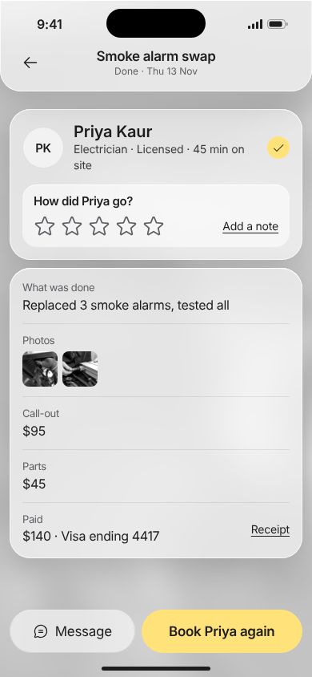
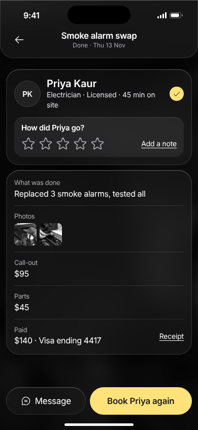

# S14 · Completed job

 

**Group:** After the job · **Frame:** iPhone 390 × 844 pt · **@3x:** `../light/S14-completed-job@3x.png`

## Purpose
One past job: rate it, see what was done and what it cost, get the receipt, and book the same tradie again.

## Entry
S13 row, or a receipt email link.

## Exits
Stars or Add a note → S12 prefilled. Receipt → the tax invoice PDF (system share sheet). Message → chat. "Book Priya again" → S02 with the tradie preselected (skips matching; S06 shows only that tradie's slots).

## Layout and components
- Top bar showing the job title, with "Done · Thu 13 Nov" as a sub line.
- A tradie card with a rating inner well (shown only if not yet rated).
- A key/value card: what was done, photos, call-out, parts, and paid with a Receipt link.
- At the bottom: Message (secondary) and "Book Priya again" (primary).

## Data
- The tax invoice: supplier name, ABN, licence, invoice number, date, line items, GST and total in AUD.

## States and edge cases
- **Already rated:** the rating well shows the stars given and "Edit".
- **The tradie no longer works with Legwork:** the primary button becomes "Book a new plumber".

## Interactions
- Pull down to dismiss.

## Accessibility
- The Receipt link's label is "Download tax invoice".

---
Copy for this screen is in `05-content/copy-deck.md`. Components are in `02-design-system/components.md`. Sample data (names, prices, PINs and licence numbers) is fictional.
